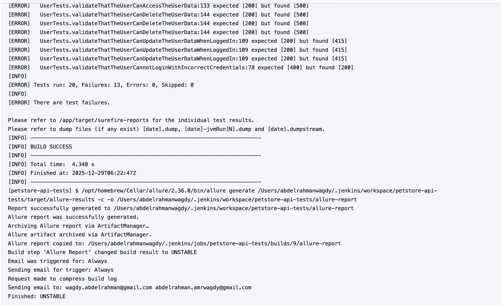
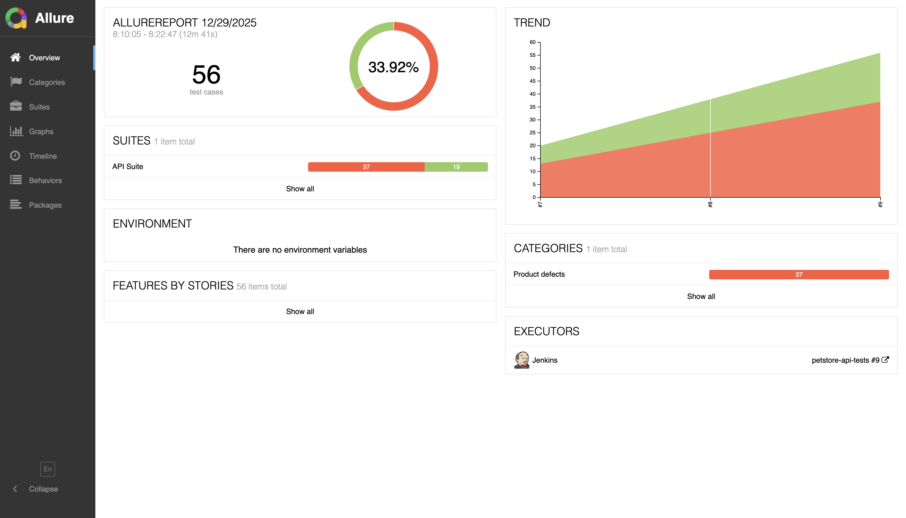
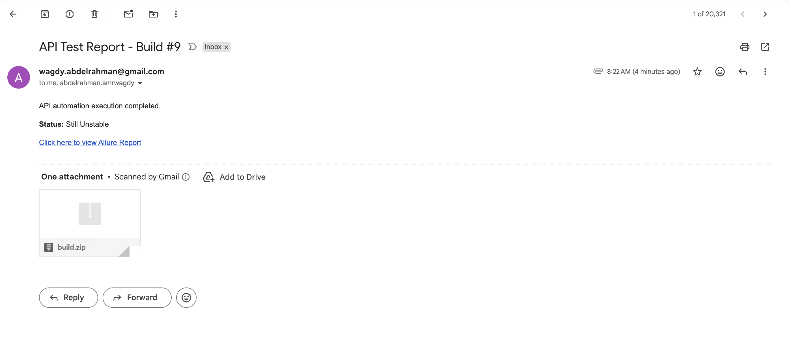

# PetStore API Automation

Java API automation for the Swagger Petstore v3 user endpoints, using REST Assured, TestNG, Docker, Jenkins, and Allure. This portfolio project demonstrates a service layer, model builders, data-driven tests, and CI reporting.

## Requirements

- JDK 21 and Maven 3.9 recommended for local execution; the POM targets Java 21.
- Network access to Maven dependencies and `petstore3.swagger.io`.
- Docker for container execution. Local Java/Maven installation is not needed for that route.
- Allure CLI to view results locally.

## Run locally

```bash
git clone https://github.com/Abdelrahman-Wagdy/PetStore.git
cd PetStore
mvn clean test
```

Endpoint configuration is in `src/test/resources/endpoints.properties`. `base.url` contains the host and path without `https://`; the service adds that prefix.

## Run with Docker

```bash
docker build -t petstore-tests .
docker run --name petstore-local petstore-tests
```

The container exits nonzero when Maven fails. Keep the stopped container long enough to collect reports, including after a failing run:

```bash
docker cp petstore-local:/app/target ./docker-test-output
docker rm petstore-local
allure serve docker-test-output/allure-results
```

Use a different container name for simultaneous local runs.

## Reports and CI

Local Allure results are written to `target/allure-results`; Surefire reports are in `target/surefire-reports`.

```bash
allure serve target/allure-results
```

The Jenkins pipeline checks out the configured SCM, builds the Docker image, runs tests, extracts Allure results, publishes the report, and removes the container. A nonzero test process marks the build **FAILED** while allowing the reporting stages to continue. Report extraction failures also fail the build.

Jenkins requires a Unix agent with Docker access, the Allure plugin and configured command-line installation, and Email Extension with SMTP configured. Review the recipient in `Jenkinsfile` before running it. Concurrent builds of the same job are disabled.

## Code map

| Location | Responsibility |
| --- | --- |
| `src/main/java/models/` | User model, builder, and test-data objects |
| `src/main/java/services/UserServices.java` | HTTP requests for user operations |
| `src/main/java/utils/Config.java` | Endpoint configuration |
| `src/test/java/usertests/UserTests.java` | User creation, read, update, deletion, login, and logout checks |
| `src/test/resources/testng.xml` | TestNG suite |
| `Dockerfile` / `Jenkinsfile` | Container execution and CI |

## Current limitations and next improvements

- Tests use fixed users and depend on shared state and ordering. Read and delete cases currently share a priority, so this is not yet an isolated or repeatable suite.
- Some negative assertions only check for a non-200 response. Replace them with contract-specific status and response checks after confirming the target API's behavior.
- The public demo service may not enforce realistic authentication rules. Login-related expectations need to be checked against its contract rather than assumed from production systems.
- Next: unique data per test, explicit setup/cleanup, independent CRUD tests, and a controlled local API for deterministic CI.
- The suite performs functional checks, not load testing. Do not use the public demo as a performance-test target.

## Existing demonstration material

These screenshots and video illustrate earlier runs; they are not evidence that the current revision passed.





[Watch the Jenkins, Docker, and Allure demonstration](docs/demo.mp4)
